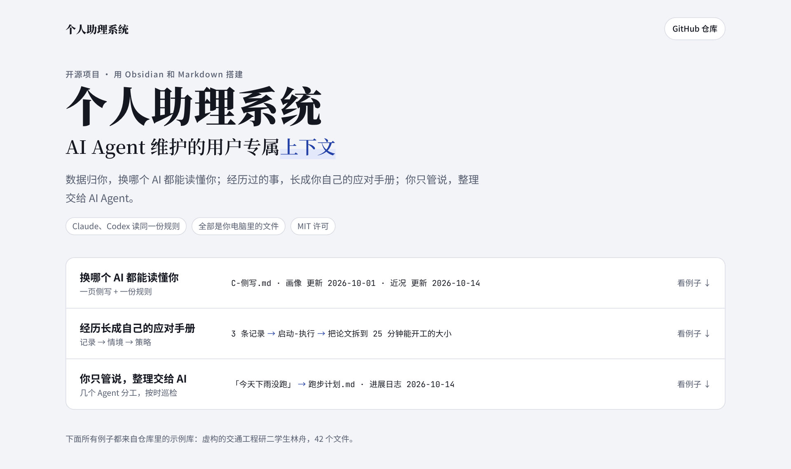
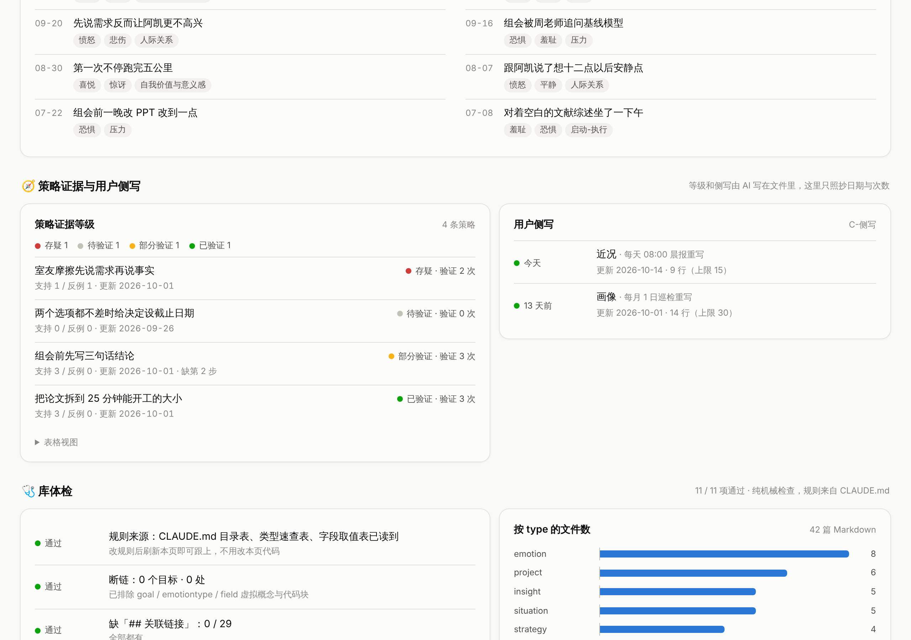

# 个人助理系统——AI Agent 维护的用户专属上下文

> 数据归你，换哪个 AI 都能读懂你；经历过的事，长成你自己的应对手册；你只管说，整理交给 AI Agent。

**English** · A personal assistant system built on a context that belongs to the user. Your notes are plain Markdown in your own Obsidian vault, and one rules file (`CLAUDE.md`, mirrored as `AGENTS.md`) tells any AI agent how to read and maintain them. Three things set it apart. The context is yours: a new agent catches up by reading one rules file and a one-page profile. Your own records grow into a personal playbook: records are grouped into situations, recurring patterns become strategies, and every strategy quotes your words and can be traced back to the specific events behind it. And you just talk: several agents split the upkeep (filing, a daily brief, a monthly review) and only ask you multiple-choice questions when they are unsure. This repo contains the rules template, a fictional sample vault, and a zero-install dashboard. Docs are in Chinese.



三个特点各配一个例子的展示页：[docs/showcase.html](docs/showcase.html)（下载后用浏览器打开）。

## 解决什么问题

1. **每换一个 AI 都要从头介绍自己**：AI 产品自带的记忆属于平台，看不到、带不走，换一个就清零。
2. **经历过的事用不上**：日记、聊天、项目文档散在各处，回头想找「上次遇到这种事我是怎么处理的」找不到；书上的方法写给所有人，不一定适合你。
3. **整理太累，坚持不下去**：自己归类、打标签、写总结，几周就放弃；让 AI 每次先问「要不要存」，问多了也烦。

## 三个特点

### 一、上下文归你：换哪个 AI 都能读懂你

上下文全是你库里的 Markdown 文件。规则写在 `CLAUDE.md`（`AGENTS.md` 是同一份，Claude、Codex 等都读）；关于你的要点汇总在一页 `C-侧写.md`：画像每月重写，近况每天重写，每条带出处。任何 AI 打开库，先读这两份，再按标签只调需要的几篇原记录。

这个做法来自作者早期的「接力文档」：每和 AI 干完一段活，就让它写一份交接文档，写清做到哪了、排除过什么、踩过什么坑、我习惯怎么做，下一个 AI 读完接着干。后来这些交接文档合成了一份规则和一页侧写。

### 二、经历长成自己的应对手册：记录 → 情境 → 策略

难受了、卡住了、想通了，随手记一条：发生了什么，当时怎么想，事后一句感悟。AI 把记录归进你定的几个情境；同一种模式出现几次，就提炼成一条策略：识别信号、机制、破解步骤，加上证据和反例的链接。

- 识别信号直接引用你当时的原话，每条结论都能点回原记录。
- 之后照着做了，有用没用都记回来；没用的次数不少于有用时，策略转为存疑，不删，等你决定。
- 书和 AI 给的建议只记作来源，不算数。
- AI 对你的推测，比如「为什么会这样」，单独标「（AI 判断）」，可以推翻。

### 三、你只管说：整理交给 AI Agent

想到什么就说一句，或往 `0-Inbox/` 丢一行字。放到哪、怎么写，由 AI 按规则判断，做完再报告；真拿不准的，写成选择题放进 `0-Unclear/` 等你勾。作者的用法是几个 Agent 分工：日常入库随时归位；每天 08:00 的晨报给当天的提醒，并重写侧写的近况；每月 1 日的巡检把新记录归进策略、重写画像；规则只有一个 Agent 能改。你只做三件事：说话、勾选择题、定规则。

多个 Agent 同时运行、定时触发是平台提供的；这个项目设计的是规则和分工，见 [人和 AI 怎么分工](docs/人和AI怎么分工.md)。

## 怎么做的

| | 做法 | 对应规则 |
|---|---|---|
| 一份规则 | 规则写在库根目录的 `CLAUDE.md`，`AGENTS.md` 是原样副本，任何 AI 读同一份 | 第二节 |
| 三层结构 | **A 执行**（项目、旅行，有状态、会结束）· **B 记录**（情绪、想法、对话、学习，原话一字不改）· **C 蒸馏**（AI 从记录里提炼的情境、策略、综述、回忆录和侧写，随时可重跑） | 第二节、铁律 1 |
| 用户侧写 | `C-侧写.md`：画像每月重写，近况每天重写，每条带出处；只当索引，引用事实回原记录 | 6.11 |
| 提炼策略 | 只在你要求或巡检时做；每条策略必须带证据和反例的链接 | 3.3 |
| 证据次数 | 策略开头三行：等级（⚪ 待验证 / 🟡 部分验证 / 🟢 已验证 / 🔴 存疑）和次数，再分别列出问题「出现」和你「照着做」的记录链接；只数你亲身经历的事，只有照着做并且有效才抬高等级 | 6.10 |
| 原话和推测分开 | 原话放「」并链回原记录；AI 对你的推测在句末标「（AI 判断）」 | 4.1 |
| 入库 | AI 自己判断放哪，原话不改；拿不准的放 `0-Unclear/`，写成选择题 | 3.1、铁律 3 |
| 巡检 | 每月 1 日处理新记录、重算证据、重写画像，在项目日志里留一条记录 | 第八节 |
| 看板 | 单个 HTML，浏览器直接读库，只列事实，并按规则做 11 项体检 | [cockpit-web](cockpit-web/README.md) |

一条策略长这样（来自虚构的示例库，`demo-vault/C-Playbook/C-Strategies/把论文拆到 25 分钟能开工的大小.md`，有删节）：

```markdown
> 🟡 部分验证 · 出现 1 次 · 执行 2 次（有效 2 / 无效 0 / 未记录 0）· 更新 2026-10-16
> 出现：[[对着空白的文献综述坐了一下午]]（2026-07-08）
> 执行：[[数据清洗拆成小块两天就做完了]]（2026-08-18，有效）· [[开工的门槛是任务大小不是意志力]]（2026-09-08，有效）

## Principle
开不了工时，问题多半出在任务太大、看不见第一步。先把它拆到“25 分钟内能开始、能做完一小块”的大小，再开工。

## 识别信号
- 「可能是“写综述”这个任务太大了，我根本不知道第一步是什么。」（[[对着空白的文献综述坐了一下午]] 2026-07-08）

## 机制
（本节为 AI 判断，依据见证据栏）
- 大任务没有清楚的第一步，开工前得先做一次“从哪开始”的决定，这个决定本身就累，于是被一再推后。

## 关联链接
**证据**：
- [[对着空白的文献综述坐了一下午]]（2026-07-08）—— “写综述”太大、没有第一步，一下午没开工，模式出现、机制解释得通（出现，不抬高等级）
- [[数据清洗拆成小块两天就做完了]]（2026-08-18）—— 数据清洗拆成六块、每块 25 分钟，挂了三周的事两天做完
- [[开工的门槛是任务大小不是意志力]]（2026-09-08）—— 第三章从一小段写起，25 分钟后停不下来
**来源**：《原子习惯》中的两分钟法则；番茄工作法以 25 分钟为一段的做法
```

三条都是林舟自己的记录，归在「启动-执行」这个情境下。7 月 8 日那次只是问题出现了，不抬高等级；另外两次照着做都有效，所以是 🟡，再有效一次才到 🟢。书里的说法只记作来源。示例库里另外三条策略分别演示：有一步还没执行过、照着做反而更糟（无效）、只有 AI 的建议还没亲身试过。

## 五分钟试一下

1. 下载本仓库。
2. 用 Edge 或 Chrome 打开 `cockpit-web/index.html`，选 `demo-vault/` 文件夹，就能看到示例库的看板。

   

3. 用 Obsidian 打开 `demo-vault/`，从 `C-Playbook/C-Strategies/` 里挑一条策略，顺着链接点回它引用的几条记录；再看根目录的 `C-侧写.md`。
4. 让你的 AI（Claude Code、Codex，或 Obsidian 里的 AI 插件）在 `demo-vault/` 里工作，说「整理收件箱」（收件箱里留了三句话，可以和展示页特点三的例子对照），或问「我最近在忙什么」，看它怎么按规则做。

## 用在自己的库上

1. 把 `rules/CLAUDE.md` 和 `rules/AGENTS.md` 复制到你的 Obsidian 库根目录。
2. 按第二节建文件夹（或直接复制 `demo-vault/` 的空文件夹结构）。
3. 改第零节的对话原则和第七节的取值表（goal、情境、领域），换成你自己的。
4. 以后想存什么就跟 AI 说，或丢进 `0-Inbox/` 说「整理收件箱」；想了解自己就问它，它会先读侧写，再按标签只调需要的几篇。
5. 想要每日晨报、每月巡检，就在你用的 AI 平台上设定时任务，让它按第八节和 6.11 做。

## 作者自己的库

这套规则来自作者自己用了三个多月的真实库（不公开）：约 250 篇笔记，从中长出 13 条应对策略，引入 AI 后改过 4 次大版本。每一版是怎么被真实问题逼出来的，见 [版本演进](docs/版本演进.md)；每条原则为什么这么定，见 [设计原则](docs/设计原则.md)。

## 隐私

- 示例库里的人物和事情全部是虚构的。作者的真实库不在这个仓库里。
- **数据归你不等于数据不出本机**：文件存在你自己电脑上、格式归你；但用云端 AI 读库时，内容会经过 AI 服务商的服务器。敏感内容要不要让 AI 读，你自己决定。

## 还没做的

- 把「整理收件箱」「每日晨报」「月度巡检」写成可以直接装的通用流程。
- 一个不依赖浏览器的规则校验脚本。
- 英文版规则。

## 许可

[MIT](LICENSE)
