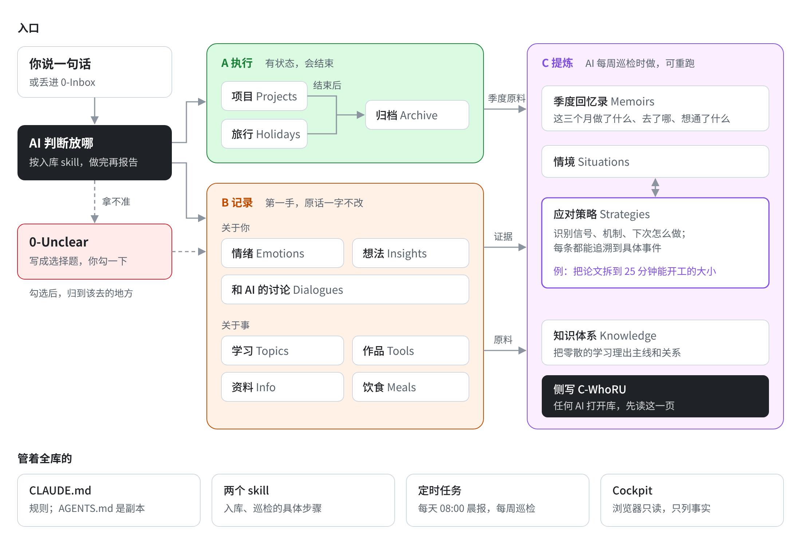

# 个人助理系统——AI Agent 维护的用户专属上下文

> 数据归你，换哪个 AI 都能读懂你；经历过的事，长成你自己的应对手册；你只管说，整理交给 AI Agent。

**English** · A personal assistant system built on a context that belongs to the user. Your notes are plain Markdown files in a folder on your own computer, and one rules file (`CLAUDE.md`) tells any AI agent how to read and maintain them. Three things set it apart. The context is yours: a new agent catches up by reading one rules file and a one-page profile. Your own records grow into a personal playbook: records are grouped into situations, recurring patterns become strategies, and every strategy quotes your words and can be traced back to the specific events behind it. And you just talk: agents do the filing, a daily update and a weekly review, and only ask you multiple-choice questions when they are unsure. Download the repo, open the folder with an AI agent, say "帮我建库" (set up my vault), and the folder becomes your own vault. It also ships a zero-install dashboard with fictional sample data. Docs are in Chinese.

## 写在前面

### 这是什么？

- **一套存储规则**：把你的工作项目、行程安排、学习笔记、情绪感受，存成你本地、完全归你所有的个人数据库。
- **一台提炼机器**：把库里的原始记录，提炼成你独有的方法论和季度回忆录，方便你复盘、调用自己已有的经验。
- **一个上下文补全器**：帮 AI 自动补全你的个人经历和偏好，让 AI 更懂你。
- **你的个人 AI 助理**：你只需要用自然语言和 AI 对话，整理、归档、提炼都交给它；它拿不准的，会出一道选择题给你勾。

我做它的初衷，是希望自己真正拥有一个第二大脑：降低不必要的摩擦与阻力，把精力和注意力保护起来，让自己变得更好。我希望你们也是。

### 这适合什么人？

爱复盘的人、长期主义者、专注自我成长的人、相信 AI 的人。

### 你需要准备什么？（只是推荐，我相信你也有更好的方案）

- **一个能读写本地文件夹的 AI Agent（必需）**：这是你和这套系统交互的窗口。我用的是 Claude Code。Codex、腾讯 WorkBuddy 这类能打开本地文件夹的 Agent 应该也行，但我没完整试过，用的时候开头说一句「先读 CLAUDE.md」更稳。只能在网页或 App 里聊天的 AI 不行，比如 DeepSeek 的聊天页面，它碰不到你电脑上的文件。
- **Obsidian（可选）**：一个 Markdown 笔记软件。我用它翻看自己的库，也用它的付费同步，让库在几台设备之间实时同步。
- **一台 24 小时开着的电脑（可选）**：配合 Agent 的定时任务，我睡觉的时候 AI 也在干活，比如每天早上更新近况、每周巡检一次。我在外面用手机跟它说话，也是靠这台电脑一直开着。

### 如何部署？

1. 下载本项目，解压出来的文件夹就是你的个人数据库，规则已经放在里面了。给它改个名，放到不会被误删的地方。
2. 用你的 AI Agent 打开这个文件夹，对它说：「帮我建库」。
3. 回答它几个问题：怎么称呼你、最近在忙什么、希望它怎么跟你说话。答完，库就建好了。
4. 以后想到什么，直接跟它说。

几个容易卡住的地方：

- **下载**：在这个页面上方点绿色的「Code」按钮，选「Download ZIP」，下载后解压。
- **打开对的文件夹**：打开后应该能看到 `CLAUDE.md`、`看板.html` 这几项。如果只看到一个同名的文件夹，说明解压多套了一层，打开里面那个。
- **用 Claude Code**：新建对话时选这个文件夹。中间可能弹窗问允不允许改文件，点允许就行。
- **问题不想答**：写「默认」，以后都能改。
- **建完以后**：关掉这个对话，重新开一个。新对话里它才会从头读一遍规则。

## 建好以后，就这样跟它聊

不用记命令，跟平时说话一样。比如：

> **你**：下周三要交开题报告。
>
> **AI**：记进「毕业论文」的待办了，标了截止日。

> **你**：今天组会被老师连着追问，回去一晚上没睡好。
>
> **AI**：照你的原话记下来了，归在「压力」这类时刻里。

> **你**：我最近都在忙什么？
>
> **AI**：先翻它给你写的那页小档案（`C-WhoRU.md`），再查最近的记录，告诉你这几周在忙的几件事，每一条都说清是从哪天的记录里看出来的。

它每动一次库，都会告诉你改了哪些文件，不对就让它撤回。拿不准放哪的，它不会瞎猜，会写成一道选择题，放进「0-Unclear」文件夹，你打开勾一下就行。

**每周跟它说一次「巡检」。** 它会把这一周你说过的事过一遍。同一种情况出现了好几次，比如每次遇到大任务都拖着开不了头，它会把你当时的原话、后来怎么解决的串起来，问你要不要整理成一条你自己的应对办法。下次再遇到，你问它「上次这种情况我是怎么办的」，它能直接告诉你，还能指出是哪几天的哪几件事。

**想看看库里都有什么**：用 Edge 或 Chrome 打开库里的「看板.html」，点右上角「打开我的库」，选这个文件夹。你在忙的事、快到期的待办、整理出来的应对办法，都在这一页上。它只看，不改你的文件。偶尔有黄色提示，比如某件事两周没动静，只是提醒，不是库坏了。


想用 Obsidian 翻：打开 Obsidian，选「打开本地文件夹作为库」，再选这个文件夹。

## 常被问到的

**它没按规矩来怎么办？**
先关掉对话，重开一个。还不行，就在开头说一句「先读 CLAUDE.md」，有的工具不会自己去读规则文件。

**我已经有 Obsidian 笔记了，能搬过来吗？**
能。先照上面建一个新库，把旧笔记**复制**一批到新库的「0-Inbox」文件夹，一次几十篇，然后说「整理收件箱」。旧笔记那边不会动。

**想改它的做法？**
直接说「以后……」，比如「以后别记我吃了什么」。它会先问你要不要写进规则里。

**能不能每天自动更新、每周自动巡检？**
要看你用的 AI 支不支持定时任务，我自己是设了的。没有也没关系：每周自己说一次「巡检」；想让它跟上你最近的状态，就说「更新近况」。

**数据安全吗？**
文件都在你自己电脑上，随时能拷走。但得说清楚：用云端的 AI 时，它读到的内容会经过 AI 公司的服务器。特别私密的东西，放不放进来你自己决定。

**建坏了怎么办？**
它只挪文件、不删文件，仓库原来的说明文件都收在一个叫 `.trash` 的隐藏文件夹里。实在乱了，删掉整个文件夹，重新下载再来一遍就好。

**不想让 AI 代劳，自己装？**
把 `CLAUDE.md` 和 `.claude/` 文件夹复制到你的库里（`.claude/skills/vault-setup` 是建库用的，可以不要），改第零节（怎么跟你说话）和第七节（在意的方面、常卡住的时刻、学习领域），再复制一份 `CLAUDE.md` 命名为 `AGENTS.md`，给 Codex 这类工具读。

## 它是怎么做的

### 一、上下文归你：换哪个 AI 都能读懂你

上下文全是你库里的 Markdown 文件。规则写在 `CLAUDE.md`；关于你的要点汇总在一页 `C-WhoRU.md`：画像每月重写，近况每天重写，每条带出处。任何 AI 打开库，先读这两份，再按标签只调需要的几篇原记录。这个做法来自我早期的「接力文档」：每和 AI 干完一段活，就让它写一份交接文档，下一个 AI 读完接着干。

### 二、经历长成自己的应对手册：记录 → 情境 → 策略

难受了、卡住了、想通了，随手记一条。AI 把记录归进你定的几类「常卡住的时刻」（情境）；同一种模式攒够几次，就提炼成一条策略：识别信号、机制、破解步骤，加上证据和反例的链接。识别信号直接引用你当时的原话；只数你亲身经历的事，书和 AI 的建议只记作来源；AI 的推测单独标「（AI 判断）」。

### 三、你只管说：整理交给 AI Agent

想到什么就说一句。放到哪、怎么写，由 AI 按规则判断，做完再报告；真拿不准的，写成选择题等你勾。你只做三件事：说话、勾选择题、定规则。多个 Agent 分工、定时触发是平台提供的；这个项目设计的是规则和分工，见 [人和 AI 怎么分工](docs/人和AI怎么分工.md)。

整体结构：你说的话先由 AI 判断放哪，归进 A 执行或 B 记录；每周巡检时，再从记录里提炼出 C 层的策略、知识体系、回忆录和侧写。

<picture>
  <source media="(prefers-color-scheme: dark)" srcset="docs/images/structure-dark.png">
  
</picture>

一条策略长这样（来自虚构人物林舟的示例，有删节）：

```markdown
> 🟡 部分验证 · 出现 1 次 · 执行 2 次（有效 2 / 无效 0 / 未记录 0）· 更新 2026-10-16
> 出现：[[对着空白的文献综述坐了一下午]]（2026-07-08）
> 执行：[[数据清洗拆成小块两天就做完了]]（2026-08-18，有效）· [[开工的门槛是任务大小不是意志力]]（2026-09-08，有效）

## Principle
开不了工时，问题多半出在任务太大、看不见第一步。先把它拆到“25 分钟内能开始、能做完一小块”的大小，再开工。

## 识别信号
- 「可能是“写综述”这个任务太大了，我根本不知道第一步是什么。」（[[对着空白的文献综述坐了一下午]] 2026-07-08）

## 机制
（本节为 AI 判断，依据见证据栏）
- 大任务没有清楚的第一步，开工前得先做一次“从哪开始”的决定，这个决定本身就累，于是被一再推后。

## 关联链接
**证据**：
- [[对着空白的文献综述坐了一下午]]（2026-07-08）—— “写综述”太大、没有第一步，一下午没开工，模式出现、机制解释得通（出现，不抬高等级）
- [[数据清洗拆成小块两天就做完了]]（2026-08-18）—— 数据清洗拆成六块、每块 25 分钟，挂了三周的事两天做完
- [[开工的门槛是任务大小不是意志力]]（2026-09-08）—— 第三章从一小段写起，25 分钟后停不下来
**来源**：《原子习惯》中的两分钟法则；番茄工作法以 25 分钟为一段的做法
```

7 月 8 日那次只是问题出现了，不抬高等级；另外两次照着做都有效，所以是 🟡，再有效一次才到 🟢。书里的说法只记作来源。

**不建库，先看看**：用 Edge 或 Chrome 打开 `看板.html`，不用选文件夹，打开就是林舟的示例库。最上面是证据链图：点一条策略，看它是被哪几条记录证明的。三个特点各配一个例子的展示页是 [docs/showcase.html](docs/showcase.html)（下载后用浏览器打开）。

想深究的：[设计原则](docs/设计原则.md)（每条规则为什么这么定，末尾有规则速览）· [版本演进](docs/版本演进.md) · [看板说明](docs/看板说明.md)。

## 作者自己的库

这套规则来自我自己用了三个多月的真实库（不公开）：约 250 篇笔记，从中长出 13 条应对策略，引入 AI 后改过 4 次大版本。每一版是怎么被真实问题逼出来的，见 [版本演进](docs/版本演进.md)。

## 隐私

- 看板和展示页里的林舟是虚构的。我的真实库不在这个仓库里。
- **数据归你不等于数据不出本机**：文件存在你自己电脑上、格式归你；但用云端 AI 读库时，内容会经过 AI 服务商的服务器。敏感内容要不要让 AI 读，你自己决定。

## 还没做的

- 把「每日晨报」也写成 skill（入库和巡检已经是）。
- 一个不依赖浏览器的规则校验脚本。
- 英文版规则。

## 许可

[MIT](LICENSE)
