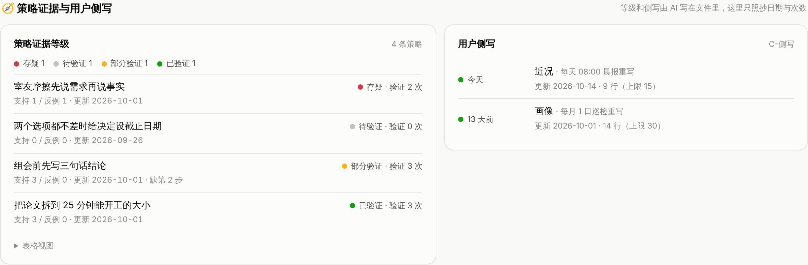

# 个人助理系统——AI Agent 维护的用户专属上下文

> 数据归你，换哪个 AI 都能读懂你；每条经验标明验证过几次，每句话都分得清是你说的还是 AI 猜的。

**English** · A personal assistant system built on a context that belongs to the user. Your notes are plain Markdown in your own Obsidian vault; AI agents keep it organized by following one rules file (`CLAUDE.md`, mirrored as `AGENTS.md`) that any agent can read. Two things set it apart: every lesson the AI distills is graded by how many first-hand experiences support or contradict it, and every sentence about you is marked as either your own words or the AI's inference. This repo contains the rules template, a fictional sample vault, and a zero-install dashboard. Docs are in Chinese.


三个特点各配一个例子的展示页：[docs/showcase.html](docs/showcase.html)（下载后用浏览器打开）。

## 解决什么问题

1. **经历散在各处**：日记、聊天、项目文档各在一个地方，回头想找「上次遇到这种事我是怎么处理的」找不到。
2. **每换一个 AI 都要从头介绍自己**：AI 产品自带的记忆属于平台，看不到、带不走，换一个就清零。
3. **AI 容易把猜测说成事实**：它会从一两条记录里编出一个完整的「你」，下次再把这个猜测当成你说过的话。

## 怎么做的

| | 做法 | 对应规则 |
|---|---|---|
| 数据归你 | 全部是你电脑里的 Markdown 文件。规则写在库根目录的 `CLAUDE.md`，`AGENTS.md` 是同一份，Claude、Codex 等都读它 | 第二节 |
| 三层结构 | **A 执行**（项目、旅行，有状态、会结束）· **B 记录**（情绪、想法、对话、学习，原话一字不改）· **C 蒸馏**（AI 从记录里提炼的经验、综述、回忆录，随时可重跑） | 第二节、铁律 1 |
| 经验分档 | 每条应对策略开头一行：⚪ 待验证 / 🟡 部分验证 / 🟢 已验证 / 🔴 存疑，只数你亲身经历过的次数，分支持和反例 | 6.10 |
| 原话和猜测分开 | 你的原话放「」里并链接到原记录；AI 对你的推测在句末标「（AI 判断）」 | 4.1 |
| 用户侧写 | `C-侧写.md`：任何 AI 先读这一页，就知道你是谁、在忙什么、要注意什么。画像每月重写，近况每天重写，每条带出处 | 6.11 |
| 多个 Agent 分工 | 入库、规则与巡检、每日晨报、移动改名各有负责人；平台负责调度，这里设计的是规则和分工 | [人和 AI 怎么分工](docs/人和AI怎么分工.md) |
| 看板 | 单个 HTML，浏览器直接读库，只列事实，并按规则做 11 项体检 | [cockpit-web](cockpit-web/README.md) |

一条经验长这样（来自虚构的示例库，`demo-vault/C-Playbook/C-Strategies/组会前先写三句话结论.md`，有删节）：

```markdown
> 🟡 部分验证 · 验证 3 次（支持 3 / 反例 0）· 更新 2026-10-01 · 缺第 2 步

## 机制
（本节为 AI 判断，依据见证据栏）
- 紧张的对象是“说不清楚”，改 PPT 是在做一件看起来相关、其实不解决问题的事。

## 关联链接
**证据**（第 1 步）：
- [[组会前一晚改 PPT 改到一点]]（2026-07-22）—— 第一次照师姐的建议写三句话，写完不慌了，组会顺利
- [[三句话写出来以后 PPT 只是配图]]（2026-08-26）—— 第二次照做，被问到缺失值也接得住
- [[组会被周老师追问基线模型]]（2026-09-16）—— 被连续追问时，靠提前写好的三句话接回了汇报
**证据**（第 2 步）：暂无
```

第 1 步亲身验证过 3 次，第 2 步一次都没有，所以整条最高只能到「部分验证」。看板会把每条经验的等级列出来：



## 五分钟试一下

1. 下载本仓库。
2. 用 Edge 或 Chrome 打开 `cockpit-web/index.html`，选 `demo-vault/` 文件夹，就能看到示例库的看板。

   

3. 用 Obsidian 打开 `demo-vault/`，翻翻 `C-Playbook/C-Strategies/` 里四条不同等级的经验，和根目录的 `C-侧写.md`。
4. 让你的 AI（Claude Code、Codex，或 Obsidian 里的 AI 插件）在 `demo-vault/` 里工作，说「整理收件箱」或「我最近在忙什么」，看它怎么按规则做。

## 用在自己的库上

1. 把 `rules/CLAUDE.md` 和 `rules/AGENTS.md` 复制到你的 Obsidian 库根目录。
2. 按第二节建文件夹（或直接复制 `demo-vault/` 的空文件夹结构）。
3. 改第零节的对话原则和第七节的取值表（goal、情境、领域），换成你自己的。
4. 以后想存什么就跟 AI 说，或丢进 `0-Inbox/` 说「整理收件箱」；想了解自己就问它，它会先读侧写，再按标签只调需要的几篇。
5. 想要每日晨报、每月巡检，就在你用的 AI 平台上设定时任务，让它按第八节和 6.11 做。

## 作者自己的库

这套规则来自作者自己用了三个多月的真实库（不公开）：约 250 篇笔记，13 条经验（8 条已验证、5 条部分验证），引入 AI 后改过 4 次大版本。每一版是怎么被真实问题逼出来的，见 [版本演进](docs/版本演进.md)；每条原则为什么这么定，见 [设计原则](docs/设计原则.md)。

## 隐私

- 示例库里的人物和事情全部是虚构的。作者的真实库不在这个仓库里。
- **数据归你不等于数据不出本机**：文件存在你自己电脑上、格式归你；但用云端 AI 读库时，内容会经过 AI 服务商的服务器。敏感内容要不要让 AI 读，你自己决定。

## 还没做的

- 把「整理收件箱」「每日晨报」「月度巡检」写成可以直接装的通用流程。
- 一个不依赖浏览器的规则校验脚本。
- 英文版规则。

## 许可

[MIT](LICENSE)
